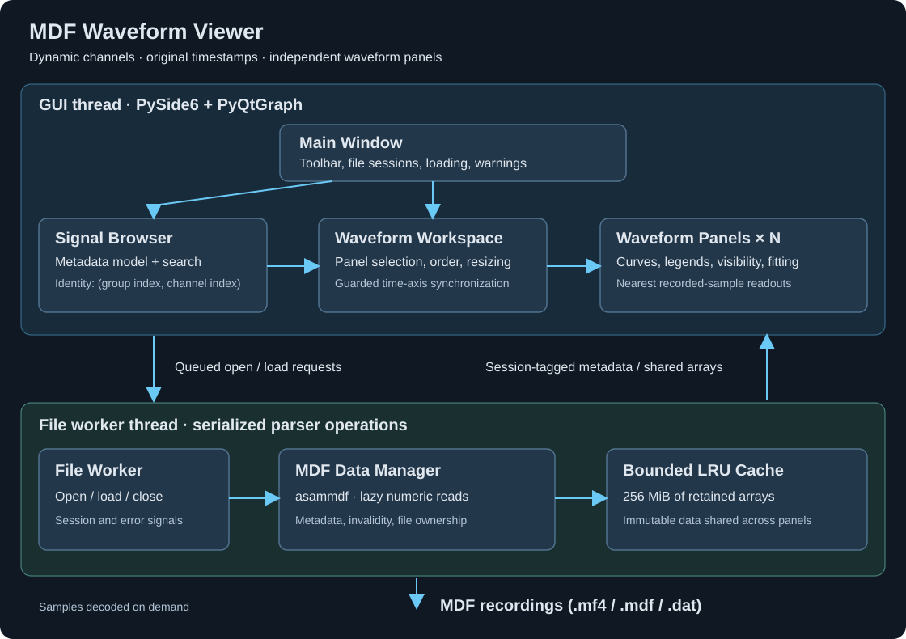

# MDF Waveform Viewer

A Python desktop application for inspecting recorded embedded firmware and
power electronics signals. Open an MDF recording, search its channels, and
organize the signals into interactive waveform panels. Channel names and panel
layouts are discovered and chosen at runtime.

## Run

Open a bundled recording directly:

```powershell
.\.venv\Scripts\python.exe -m mdf_viewer examples\motor_drive.mf4
```

## Build the Windows application

After the installation steps above, run:

```powershell
powershell -NoProfile -ExecutionPolicy Bypass -File .\tools\build.ps1
```

This runs PyInstaller to create **`dist\MDFViewer\MDFViewer.exe`**. Launch it with:

```powershell
.\dist\MDFViewer\MDFViewer.exe .\examples\motor_drive.mf4
```

## Using the viewer

1. Click **Open MDF…** (`Ctrl+O`). MDF4 is the primary format; the file dialog
   also accepts `.mdf` and `.dat` recordings supported by asammdf.
2. Search the left browser by name, unit, identity, or description. The table
   includes each channel's group/index identity, sample count, and panel usage.
   Time-master channels provide the time axis and are excluded from the list.
3. Select a panel using **Select** or by clicking its plot. A blue border and
   the browser's **Target** label identify the destination. Double-click a
   signal, or select several using Ctrl/Shift and click **Add selected signals
   to panel**. You can also drag one or more selected signals directly onto any
   waveform; the destination panel becomes selected. Samples load only when requested.
4. Use **Add waveform panel** (`Ctrl+N`) as needed. Rename panels in their
   headers, reorder them with the arrows, drag the divider between panels to
   resize, and scroll to reach panels below the window.
5. The list beside each waveform shows its signals, colors, recorded values,
   and sample times. Use a signal's checkbox to hide it or its **×** button to
   remove it. Hover over the name for its description and data status.
   Removing a panel leaves the other panels intact. If all
   panels are removed, adding a signal creates a new panel.
6. Use the mouse wheel to zoom and left-drag to pan. Drag or scroll over an
   axis to change that axis alone. Time axes synchronize by default; uncheck
   **Synchronize time axes** to navigate panels independently. Y ranges remain
   independent. **Separate Y scales** is enabled by default: each signal has
   its own colored axis, so different units or magnitudes do not flatten other
   traces. Uncheck it to compare signals on one shared Y-axis. Original values
   and units are retained in either mode.
7. **Fit time + Y** resets a panel's range; **Fit all panels** (`Ctrl+0`) fits
   the full time span across panels. **Auto Y** follows the visible data;
   manual vertical navigation disables it. **Fit Y to visible time** fits the
   samples within the current time window.
8. Hover over a plot for recorded-value readouts. Every row shows its own
   nearest sample's timestamp and value with units. The cursor's time may
   differ from a sample's time, especially for low-rate or irregular channels.
   Values are never interpolated. Outside a channel's recorded span, the
   nearest endpoint is shown with its actual timestamp.

See [the example recordings](examples/README.md) for ready-to-use files and
their generation command.

## Architecture



| Component | Responsibility |
| --- | --- |
| [`app.py`](src/mdf_viewer/app.py) | Application entry point, command-line file selection, Qt styling |
| [`window.py`](src/mdf_viewer/window.py) | Toolbar, component coordination, queued loading, session lifecycle, warnings |
| [`browser.py`](src/mdf_viewer/browser.py) | Metadata table and searchable proxy model; emits selected channel identities |
| [`workspace.py`](src/mdf_viewer/workspace.py) | Creates, selects, removes, resizes, and reorders panels; guards synchronized range updates against recursion |
| [`panel.py`](src/mdf_viewer/panel.py) | PyQtGraph curves, visibility, legends, fitting, nearest recorded-sample inspection |
| [`worker.py`](src/mdf_viewer/worker.py) | Serializes all parser calls on one QThread; tags results with a recording session |
| [`data.py`](src/mdf_viewer/data.py) | MDF metadata discovery, `(group, index)` identity, lazy numeric reads, invalid samples, file ownership, bounded LRU cache |

The browser discovers metadata without decoding every channel's samples.
Decoding, sample normalization, and cache operations run on the file worker;
Qt widgets and plots stay on the GUI thread. Multiple panels reuse the same
immutable cached arrays. The cache retains up to 256 MiB of timestamp/sample
arrays; evicted data still being displayed remains owned by its panels.
Channels larger than the cache budget can be displayed without being cached.
Removing a trace releases its panel references; switching recordings clears
the cache and closes the previous file. Closing the application waits for
outstanding file work, then releases the parser and worker thread.

Every signal uses its recorded timestamps, without resampling. Non-finite
timestamps are dropped, and out-of-order timestamps are stably sorted with
their associated samples; these adjustments appear in the status column.
Finite curves use view clipping and peak-envelope downsampling for rendering
while readouts always use original samples. Downsampling is disabled for curves
with invalid samples so gaps stay visible.

## Testing

`motor_drive.mf4`
`edge_cases.mf4`.
